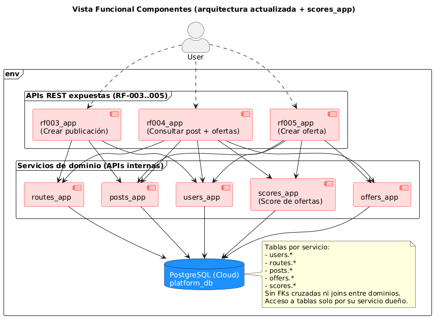
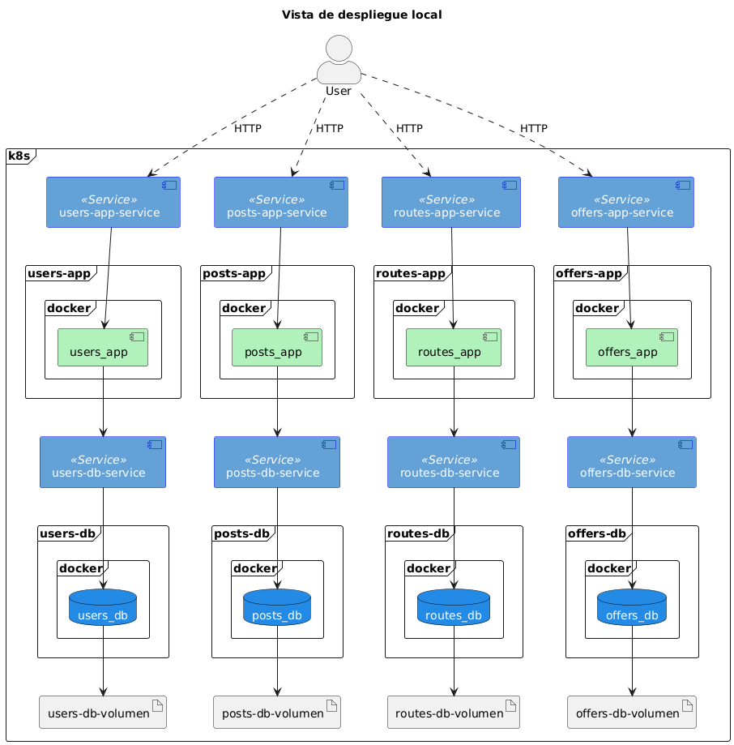

# 📌 Equipo

**Nombre del equipo:** DANN_MISO_MAIA  
**Líder:** Manuel Eduardo Estévez Bretón Ruiz  

---

## 👥 Integrantes

### Manuel Eduardo Estévez Bretón Ruiz
- **GitHub:** manuelestevezb
- **Correo:** me.estevez-breton10@uniandes.edu.co
- **Rol:** Estudiante de maestría en Inteligencia Artificial. Egresado del pregrado en Administración de Empresas (Cum Laude).
- **Intereses:** Inteligencia Artificial y ciencia de datos.

---

### Jorge Luis Paternina Montiel
- **GitHub:** jorgepaternina2 
- **Correo:** j.paterninam@uniandes.edu.co 
- **Rol:** Estudiante de maestría en Inteligencia Artificial. Egresado de Administración de Empresas y Negocios Internacionales.  
- **Intereses:** IA genetativa y sistemas de recomendaciones.   

---

### Daniel Felipe Díaz Moreno
- **GitHub:** ddi4z
- **Correo:** d.diazm@uniandes.edu.co
- **Rol:** Estudiante de pregrado y monitor de ISIS3510 e ISIS3710.
- **Intereses:** Arquitecturas, diseño de sistemas y computación en la nube.

---

### Javier Steven Barrera Toro
- **GitHub:** j4vierb
- **Correo:** js.barrerat1@uniandes.edu.co
- **Rol:** Estudiante de pregrado.
- **Intereses:** Arquitectura y diseño de software. Procesamiento y manejo de datos a gran escala. Aprendizaje automático.

---

## 📅 Reglas del equipo

### 1. Forma de trabajo
- Reuniones los domingos a las 6:00 p. m., hora Colombia, para seguimiento y listado de bloqueos principales.  
- Dos semanas antes de cada entrega, la reunión será el inicio (*kick-off*) de la misma.  
- En cada reunión se definen el enfoque, la asignación de tareas y los responsables. Esto debe quedar documentado en el kanban.

### 2. Fechas de entrega
- Tener las entregas listas el jueves de la semana de entrega (entrega oficial: sábado).  
- Utilizar viernes y sábado para revisión y corrección.

### 3. Gestión de retrasos
- Avisar si no se podrá cumplir la fecha límite a más tardar el domingo anterior.  
- La única excepción serán casos de fuerza mayor (por ejemplo, incapacidad médica).  
- En caso de excepción, el integrante se compromete a subir al repositorio su avance preliminar.  
- Redistribuir o ajustar tareas según la situación.

### 4. Comunicación
- Usar el grupo de WhatsApp como medio principal de comunicación para dudas, actualizaciones y problemas.  
- Evitar avisos de último momento para permitir ajustes.

### 5. Resolución de conflictos
- Resolver mediante reunión virtual.  
- Si el conflicto es entre dos personas, los demás actúan como mediadores.  
- Si es entre tres o más personas, se realizará una reunión para escuchar todas las perspectivas y definir alternativas.

### 6. Tecnologías a usar
- Python, Poetry, FastAPI, Pytest y Docker.

# Documentación técnica del proyecto

## Vistas de arquitectura

* Vista de componentes
  

* Vista de despliegue

* Vista de redes

* Vista de información

