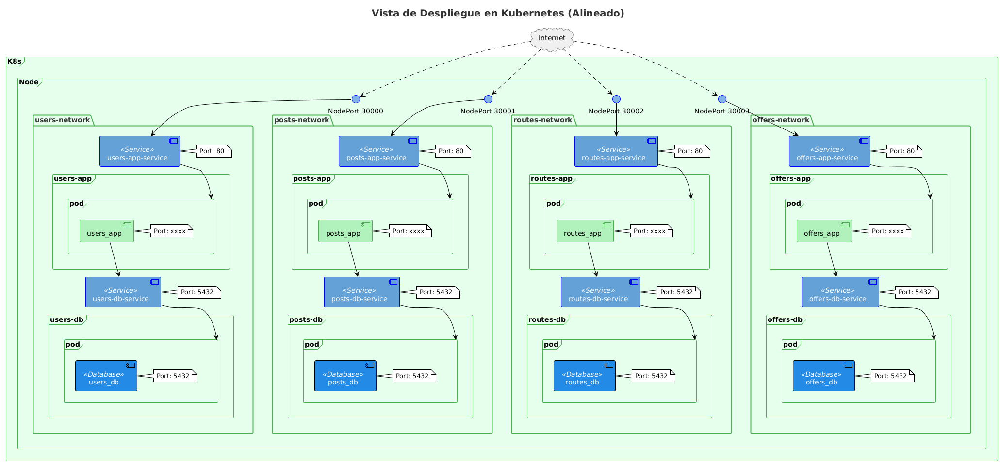
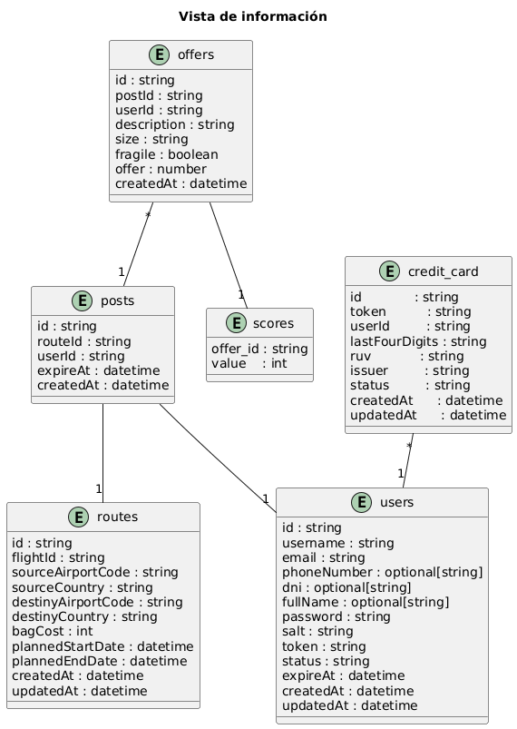

# Equipo

**Nombre del equipo:** DANN_MISO_MAIA  
**Líder:** Manuel Eduardo Estévez Bretón Ruiz  

---

## Integrantes

### Manuel Eduardo Estévez Bretón Ruiz
- **GitHub:** manuelestevezb
- **Correo:** me.estevez-breton10@uniandes.edu.co
- **Rol:** Estudiante de maestría en Inteligencia Artificial. Egresado del pregrado en Administración de Empresas (Cum Laude).
- **Intereses:** Inteligencia Artificial y ciencia de datos.

---

### Jorge Luis Paternina Montiel
- **GitHub:** jorgepaternina2 
- **Correo:** j.paterninam@uniandes.edu.co 
- **Rol:** Estudiante de maestría en Inteligencia Artificial. Egresado de Administración de Empresas y Negocios Internacionales.  
- **Intereses:** IA genetativa y sistemas de recomendaciones.   

---

### Daniel Felipe Díaz Moreno
- **GitHub:** ddi4z
- **Correo:** d.diazm@uniandes.edu.co
- **Rol:** Estudiante de pregrado y monitor de ISIS3510 e ISIS3710.
- **Intereses:** Arquitecturas, diseño de sistemas y computación en la nube.

---

### Javier Steven Barrera Toro
- **GitHub:** j4vierb
- **Correo:** js.barrerat1@uniandes.edu.co
- **Rol:** Estudiante de pregrado.
- **Intereses:** Arquitectura y diseño de software. Procesamiento y manejo de datos a gran escala. Aprendizaje automático.

---

## Reglas del equipo

Estas reglas las puede encontrar en [Reglas de equipo](./reglas_equipo.md). Esto lo hacemos para que esta página sirva de punto central a los demás puntos de información. 

# Documentación técnica del proyecto

## Vistas de arquitectura

* Vista de componentes
  

* Vista de despliegue

* Vista de redes

* Vista de información

