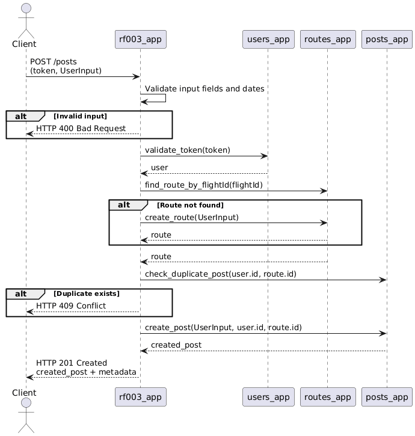
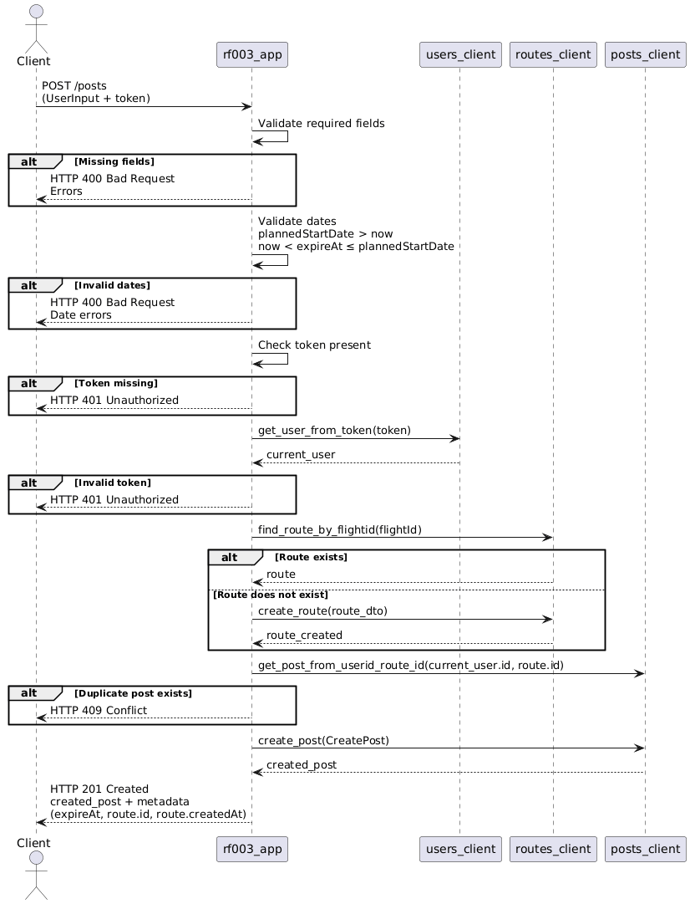

# RF-003 — Crear publicación

## Secuencia resumida
1. `rf003_app` recibe `token` + `UserInput`.  
2. Valida campos y fechas.  
3. Valida token con `users_app`.  
4. Busca `route` por `flightId`; si no existe, lo crea en `routes_app`.  
5. Verifica duplicidad en `posts_app` por `(user_id, route_id)`.  
6. Crea la publicación en `posts_app`.  
7. Devuelve `201` con la publicación creada y metadatos.

---

## Entradas (request)
- **token** (string, Bearer token) — requerido.
- **UserInput** con campos obligatorios:
  - `flightId`, `expireAt`, `plannedStartDate`, `plannedEndDate`,
  - `origin.{airportCode,country}`, `destiny.{airportCode,country}`,
  - `bagCost`.

> Si falta un campo obligatorio: `ValidationError("Inputs faltantes")`

---

## Flujo principal (exitoso)
1. **Validar completitud de entrada.**  
   Si falta algún campo requerido → *ver errores*.
2. **Validar fechas.**  
   - `plannedStartDate` debe ser **futuro** respecto a “ahora”.  
   - `expireAt` debe cumplir: **ahora < expireAt ≤ plannedStartDate**.  
   Si no se cumple → *ver errores de fecha*.
3. **Validar token presente.**  
   Si no hay token → *ver errores*.
4. **Autenticar usuario.**  
   `users_client.get_user_from_token(token)` → debe devolver `current_user`.  
   Si retorna `None` → *ver errores de autenticación*.
5. **Resolver trayecto (route).**  
   - Buscar por `flightId`: `routes_client.find_route_by_flightid(flightId)`.  
   - **Si existe:** usar el **route** almacenado (se descartan datos del request).  
   - **Si NO existe:** construir `RouteCreateInput` con los datos recibidos y **crear**:  
     `routes_client.create_route(route_dto)` → obtener `route_created`.
6. **Verificar duplicidad de publicación para el trayecto.**  
   `posts_client.get_post_from_userid_route_id(user_id=current_user.id, route_id)`  
   - **Si existe un post** del mismo usuario para ese `route_id` → *conflicto*.
7. **Crear publicación.**  
   Construir `CreatePost` y llamar `posts_client.create_post(...)`.  
   Obtener `created_post`.
8. **Responder.**  
   Devolver datos de la publicación creada (y metadatos de `expireAt`, `route.id`, `route.createdAt`).

---

## Flujos de excepción y manejo de errores

| Paso | Condición / Falla | Excepción en el caso de uso | Respuesta |
|---|---|---|---|
| 1 | Falta cualquier campo obligatorio | `ValidationError("Inputs faltantes")` | **400** |
| 2 | `plannedStartDate` no es futuro | `InvalidRouteDatesError("la fecha de inicio debe estar en el futuro.")` | **412** |
| 2 | `expireAt` no cumple `ahora < expireAt ≤ plannedStartDate` | `InvalidExpiredAtError("...")` | **412** |
| 3 | Token ausente | `NoTokenError("Token no está en la solicitud")` | **403** |
| 4 | Token inválido / usuario no resuelto | `InvalidTokenError("Usuario no autorizado")` | **401** |
| 5 (buscar/crear route) | Fallo de comunicación con `routes_app` | `ServiceCommunicationError("routes")` | **503** |
| 6 (verificar duplicidad) | Ya existe post del usuario para ese `route_id` | `ConflictError("Usuario ya tiene ruta para ese trayecto")` | **412** |
| 7 (crear post) | Fallo de comunicación con `posts_app` o validación fallida en posts | `ServiceCommunicationError("posts")` *(adapter)* u otro error del dominio de posts | **503** 

---

## Respuesta (éxito)
- `created_post` (objeto con `id`, timestamps, etc.).  
- Metadatos devueltos por el caso de uso: `expireAt`, `route.id`, `route.createdAt`.  
- **HTTP 201 Created** sugerido en la API.

---

### Observabilidad y seguridad
- Propagar `X-Request-Id`, **logs estructurados** por paso, y métricas (intentos/éxitos/errores por tipo).  
- Autenticación Bearer token en la capa RF; autorización basada en `user_id`.
