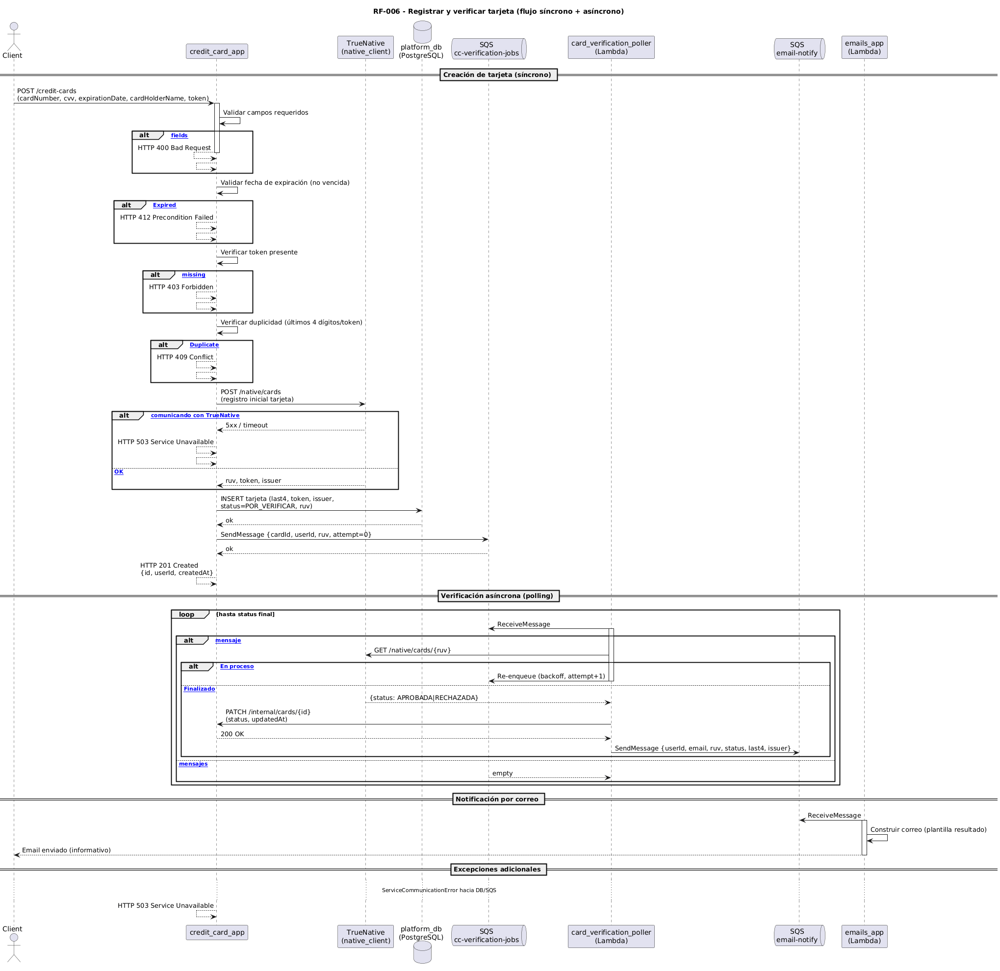

# RF-006 — Crear y Validar Tarjetas de crédito

## Secuencia resumida
1. credit_card_app recibe datos de tarjeta (`cardNumber`, `cvv`, `expirationDate`, `cardHolderName`) junto con `token` del usuario.  
2. Valida formato, vigencia y duplicidad.  
3. Envia la tarjeta a TrueNative (`POST /native/cards`) junto con un transactionIdentifier.  
4. TrueNative responde con un RUV y un token de tarjeta.  
5. credit_card_app almacena en la base de datos los metadatos permitidos (últimos 4 dígitos, token, issuer, estado=POR_VERIFICAR).  
6. Publica un mensaje en SQS (`cc-verification-jobs`) con el RUV y userId.  
7. card_verification_poller (Lambda) consume el mensaje y consulta a TrueNative (`GET /native/cards/{ruv}`).  
8. Si estado=202 → reintenta después de un delay; si estado=200 → recibe resultado (APROBADA/RECHAZADA).  
9. card_verification_poller actualiza la tarjeta en credit_card_app vía API interna (PATCH estado).  
10. card_verification_poller publica evento en SQS (`email-notify`).  
11. emails_app (Lambda) consume `email-notify` y envía notificación al usuario vía SES.

---

## Entradas
- token (Bearer, requerido)  
- cardNumber, cvv, expirationDate, cardHolderName (campos requeridos en body JSON)

---

## Flujo principal (éxito)
1. Autenticación y validación de datos en credit_card_app.  
2. Llamada a TrueNative para registrar la tarjeta.  
3. Almacenamiento en DB con estado inicial POR_VERIFICAR.  
4. Publicación de trabajo en cola cc-verification-jobs.  
5. card_verification_poller consulta estado en TrueNative hasta obtener resultado final.  
6. Actualización del estado en credit_card_app.  
7. Publicación en email-notify → emails_app envía notificación al usuario.

---

## Excepciones y manejo

| Paso | Condición | Excepción / Respuesta | HTTP sugerido |
|---|---|---|---|
| 1 | Token inválido o ausente | InvalidTokenError | 401 / 403 |
| 1 | Datos incompletos o malformados | ValidationError | 400 |
| 1 | Tarjeta duplicada | ConflictError | 409 |
| 1 | Tarjeta vencida | InvalidExpiredAtError | 412 |
| 3–5 | Error al comunicar con TrueNative | ServiceCommunicationError | 503 |
| 7 | Estado sigue en 202 después de varios reintentos | Mensaje en DLQ / alerta | N/A |

---

## Respuesta (éxito)
- Al crear tarjeta (`POST /credit-cards`):  
  - HTTP 201  
  - JSON con `id`, `userId`, `createdAt`.  
- Al listar (`GET /credit-cards`):  
  - HTTP 200  
  - JSON con lista de tarjetas (`id`, `userId`, `lastFourDigits`, `issuer`, `status`, `createdAt`, `updatedAt`, `token*`).  

---

## Componentes involucrados
- Ingress (exposición HTTP)  
- credit_card_app (servicio principal RF-006)  
- TrueNative (servicio externo simulado)  
- PostgreSQL RDS (platform_db)  
- Amazon SQS (cc-verification-jobs, email-notify)  
- card_verification_poller (AWS Lambda)  
- emails_app (AWS Lambda)  
- Amazon SES (envío de correos)  
