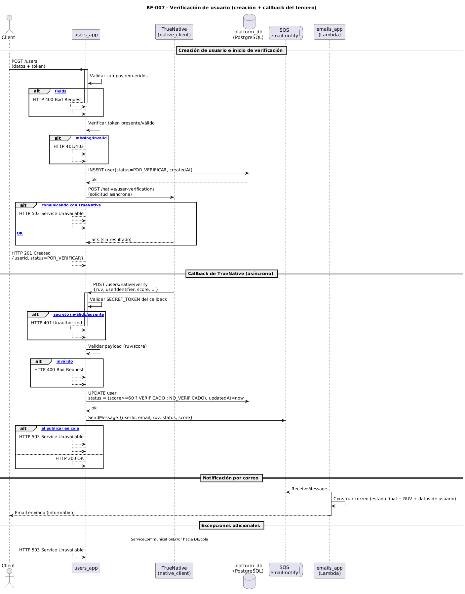

# RF-007 — Consultar Publicaciones

## Secuencia resumida
1. users_app crea al usuario con estado POR_VERIFICAR al registrarlo.
2. users_app envía una solicitud de verificación a TrueNative (incluye un identificador propio para trazabilidad).
3. TrueNative procesa de forma asíncrona y realiza un callback al webhook expuesto por users_app con el RUV y un puntaje de 1–100.
4. users_app calcula el resultado: puntaje ≥ 60 → VERIFICADO; de lo contrario → NO_VERIFICADO.
5. users_app actualiza el estado del usuario y la fecha de actualización.
6. users_app publica un evento en la cola de email para notificar el resultado.
7. emails_app consume el evento y envía un correo al usuario con el estado final, el RUV y los datos relevantes del usuario.

---

## Entradas
- token (Bearer) para crear/administrar usuarios (según el endpoint expuesto).
- Datos del usuario a verificar (los necesarios para la verificación en TrueNative).
- Callback entrante desde TrueNative hacia el webhook de users_app con RUV y puntaje.

---

## Flujo principal (éxito)
1. users_app registra al usuario con estado inicial POR_VERIFICAR.
2. users_app solicita verificación a TrueNative (modo asíncrono).
3. TrueNative envía callback al webhook en users_app con RUV y puntaje.
4. users_app determina el estado final:
   - Si el puntaje es mayor o igual a 60 → estado VERIFICADO.
   - Si el puntaje es menor a 60 → estado NO_VERIFICADO.
5. users_app persiste el cambio de estado y actualiza la fecha de modificación.
6. users_app publica un mensaje en la cola de notificaciones.
7. emails_app envía el correo al usuario con el resultado del proceso.

---

## Excepciones y manejo

| Paso | Condición | Excepción / Respuesta | HTTP sugerido |
|---|---|---|---|
| 1 | Datos de creación inválidos o token ausente/incorrecto | ValidationError / InvalidTokenError | 400 / 401 / 403 |
| 2 | Falla al solicitar verificación al tercero | ServiceCommunicationError | 503 |
| 3 | Callback sin autenticación válida o malformado | UnauthorizedCallbackError / ValidationError | 401 / 400 |
| 4 | Puntaje inválido o fuera de rango | ValidationError | 400 |
| 6 | Error al publicar notificación | QueuePublishError | 503 |

---

## Respuesta (éxito)
- Al crear el usuario: confirmación de creación con estado POR_VERIFICAR.
- Tras el callback y actualización:
  - El usuario queda en VERIFICADO (puede acceder) o en NO_VERIFICADO (no puede acceder).
  - Se envía un correo con estado final, RUV y los datos relevantes del usuario.
  - Los endpoints de lectura de usuario reflejan el estado y la fecha de actualización.

---

## Componentes involucrados
- Ingress (exposición HTTP)
- users_app (API y webhook de verificación)
- TrueNative (proveedor simulado que realiza el callback con RUV y puntaje)
- Amazon SQS (cola de notificaciones de email)
- emails_app (Lambda para envío de correos)
- PostgreSQL RDS (platform_db)
