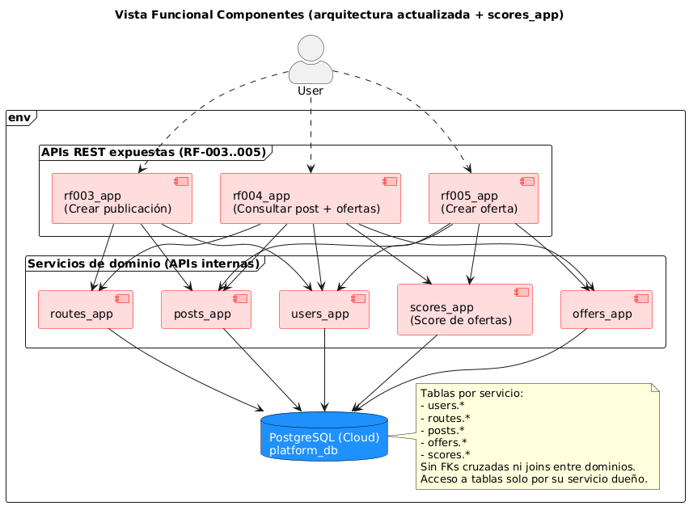
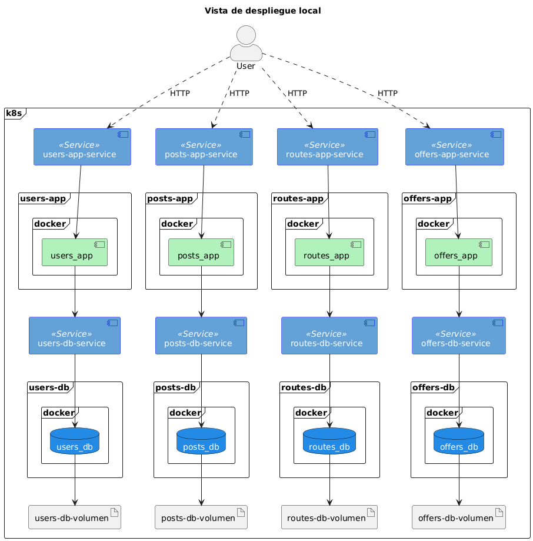
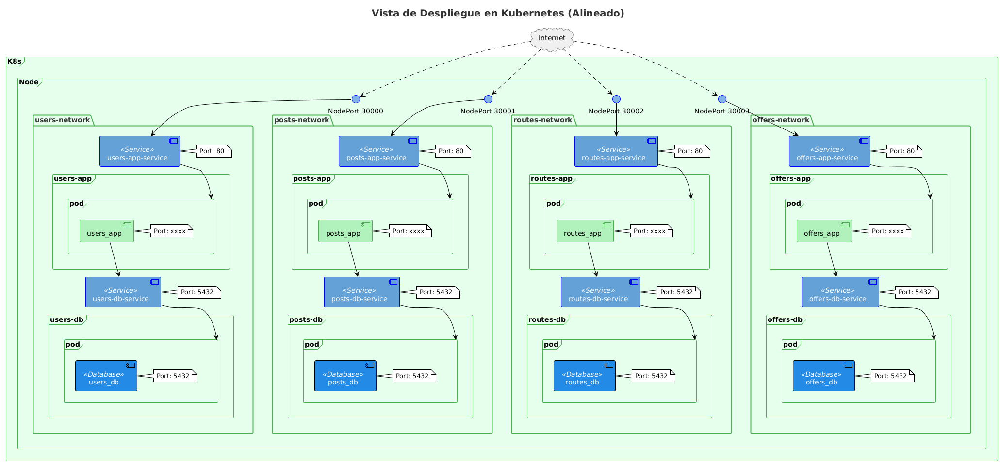
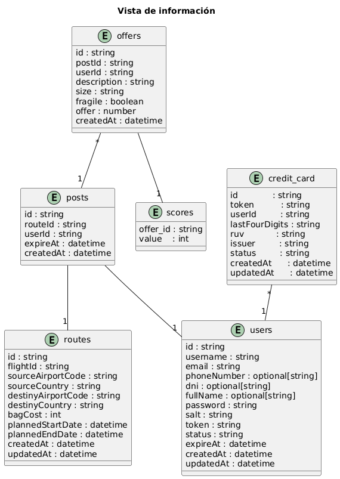

# Vistas de arquitectura

## Vista de componentes
  


Arquitectura por servicios con propiedad de datos por dominio y acoplamiento bajo, enfocada en cubrir funcionalidades esenciales de la primera entrega.
- Actor: User interactúa con los servicios vía cliente/APIs (líneas punteadas).
- Servicios (cajas rosadas): users_app, posts_app, offers_app, routes_app; cada uno es desplegable de forma independiente y expone una API.
- Persistencia (cilindros azules): cada servicio posee su propia BD (users_db, posts_db, offers_db, routes_db); sin acceso cruzado; intercambio entre dominios vía APIs.
- Entorno (env): encapsula los procesos en un mismo stack/cluster; habilita escalado y despliegue independientes.


## Vista de despliegue



Despliegue local en un clúster k8s (p. ej., minikube/kind). 
- Acceso del usuario: el User consume las APIs vía HTTP a través de los Services de las apps.
- Patrón por dominio (users, posts, routes, offers):
  - App: contenedor Docker (*_app) ejecutado en k8s y expuesto por un Service.
  - Base de datos: contenedor (*_db) accesible mediante su Service interno.
  - Persistencia: volumen dedicado para la BD (PVC/PV) para evitar pérdida de datos al reiniciar pods.
- Comunicación: cada app se conecta solo a su BD vía el Service correspondiente (sin acceso cruzado).
- Operación: componentes aislados y escalables de forma independiente.

## Vista de redes



K8s con cuatro dominios lógicos/“networks”: users, posts, routes, offers.
- Exposición externa: cada app se publica vía Service NodePort; el usuario accede por Internet → NodePort → *-app-service (HTTP :80) → pod *_app.
- Acceso a datos: la app se conecta a su propia BD vía ClusterIP *-db-service (:5432) → pod *_db. No hay acceso cruzado entre bases ni entre dominios.
- Aislamiento y escalabilidad: cada dominio puede escalarse y desplegarse de forma independiente manteniendo propiedad de datos por servicio.

## Vista de información



Modelo lógico de datos para la primera iteración. Muestra entidades clave, atributos y relaciones.

## Vista de desarollo 

Se opta por utilizar una estructura similar a las 4 aplicaciones. Tomando como base la arquitectura hexagonal (aka. Puertos y adaptadores) se definen las carpetas `domain`, `adapters` y `entrypoints`. En la primera carpera se almacenaran las clases del dominio, los puertos y los casos de uso, mientras que en la segunda y tercera carpeta irán respectivamente los adaptadores (implementaciones de los puertos) y los puntos de entrada a la aplicación, la API REST. 

```
.
├── src/
│   ├── domain/             # Capa de dominio
│   │   ├── models/         # Modelos de dominio
│   │   ├── ports/          # Puertos (interfaces)
│   │   └── use_cases/      # Casos de uso
│   ├── adapters/           # Capa de adaptadores
│   │   └── database/       # Adaptador de base de datos
│   └── entrypoints/        # Puntos de entrada
│       └── api/            # API REST
├── tests/                  # Pruebas
│   ├── domain/             # Pruebas de la capa de dominio
│   │   ├── models/         # Pruebas de los modelos
│   │   ├── ports/          # Pruebas de los puertos
│   │   └── use_cases/      # Pruebas de los casos de uso
│   ├── adapters/           # Prueba de los adaptadores
│   └── entrypoints/        # Prueba de la API y puntos de entrada
├── Dockerfile              # Configuración de Docker
├── pyproject.toml          # Configuración de Poetry
└── README.md               # Este archivo
```

### Tabla de tecnologias

| Tecnología      | Descripción | Desarrollo, ejecución, pruebas o despliegue |
|-----------------|-------------|---------------------------------------------|
| Poetry          | Manejador de dependencias y empaquetado para proyectos en Python. Cada aplicación lo utilizo para manejar las dependencias. | Desarrollo |
| FastAPI         | Framework moderno y rápido para construir APIs con Python. Cada una de las aplicaciones esta desarrollado con esto. | Desarrollo |
| pytest          | Framework de pruebas para Python. Todas las aplicaciones se probaron con este framework. | Pruebas |
| PostgreSQL      | Base de datos relacional. En principio se desarrollaron todas las aplicaciones para conectarse a una base de datos de este tipo. | Ejecución |
| PlantUML        | Herramienta para generar diagramas a partir de texto. | Desarrollo |
| Postman         | Se utilizó para realizar las pruebas de la API con las colecciones ya definidas. | Pruebas |
| Docker          | Plataforma de contenedores para empaquetar y ejecutar aplicaciones. Todas las aplicaciones se empaquetaron con esto. | Ejecución |
| Minikube        | Herramienta para correr Kubernetes en local. | Despliegue |
| GitHub Actions  | Servicio de CI/CD integrado en GitHub. Para el proyecto solo se utilizo para integración continua: linter y la ejecución de las pruebas. Además, se utilizaron en los evaluadores. | Despliegue |
