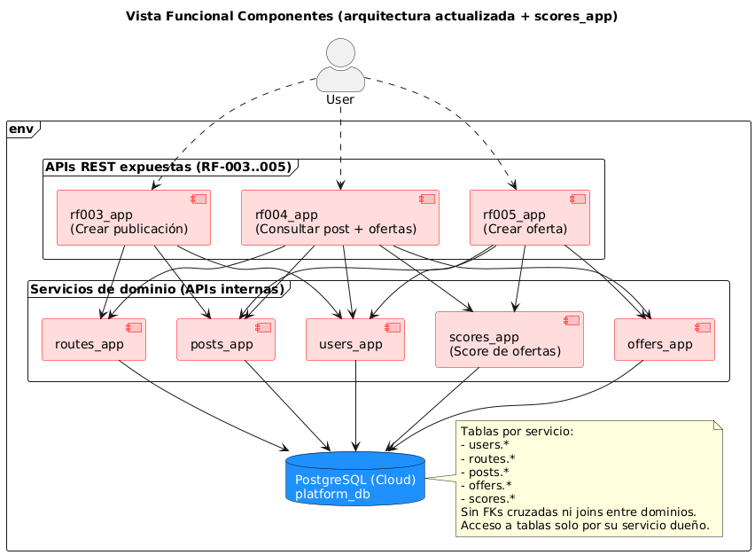

## Vista de componentes
  

Arquitectura por servicios con propiedad de datos por dominio y acoplamiento bajo, con integración a un validador de usuarios y tarjetas externo, enfocada en cubrir funcionalidades esenciales de la tercera entrega.

## Descripción del sistema

### Actor (líneas punteadas)
El **User** interactúa vía **API REST** exclusivamente con los **nuevos servicios expuestos**:
- **RF-003 Crear Publicación** → `POST /rf003/posts`
- **RF-004 Crear Ofertas** → `POST /rf004/posts/{id}/offers`
- **RF-005 Consultar Publicaciones** → `GET /rf005/posts/{id}`
- **RF-006 Gestión de Tarjetas de Crédito** → `POST /credit-cards` (aunque tiene otros para otras acciones, como consultar tarjetas)
- **RF-007 Verificación de Usuario** → vía callback recibido en `POST /users/native/verify`

Autenticación por Bearer Token.  
Los servicios de dominio se consumen de forma interna por los RF-003–005 y también por los nuevos orquestadores RF-006–007.

### Servicios (cajas rosadas)
- **Orquestadores/fachada:** `rf003_app`, `rf004_app`, `rf005_app`, `credit_card_app` (exponen las APIs al usuario).  
- **Servicios de dominio:** `users_app`, `routes_app`, `posts_app`, `offers_app`, `scores_app`.  
- **Servicios de soporte:**  
  - `polling_worker` (verificación asíncrona de tarjetas RF-006).  
  - `email_service` (envío de correos tanto para tarjetas RF-006 como usuarios RF-007).  
- **Servicios externos integrados:**  
  - `TrueNative` (proveedor simulado de verificación de tarjetas y usuarios).  

Todos son **desplegables de forma independiente** y se comunican entre sí vía **HTTP/JSON** o **colas SQS**.  
No existe acceso directo a datos ajenos: cada dominio mantiene su encapsulamiento.

### Persistencia (cilindro azul)
- **Una sola base de datos PostgreSQL en la nube** (en AWS).  
- Cada servicio **posee sus propias tablas** (y/o *schema* lógico) dentro de esa BD única:  
  - `users.*`  
  - `routes.*`  
  - `posts.*`  
  - `offers.*`  
  - `scores.*`  
  - `credit_cards.*`  
- **Sin llaves foráneas cruzadas** entre dominios; **no** se realizan *joins* entre tablas de servicios distintos.  
- La **propiedad y acceso** a cada tabla es exclusivo del servicio correspondiente;  
  el **intercambio entre dominios es vía APIs o eventos en colas**.  
- Consistencia garantizada por **transacciones** y reglas de negocio en cada servicio.

### Entorno (env)
Un mismo **stack/cluster** (ej: Kubernetes + Ingress) encapsula los procesos y habilita  
**escalado y despliegue independientes** por servicio.  

Las conexiones a la BD en la nube se manejan mediante **secrets** y políticas de red/VPC.  
Se propaga `X-Request-Id` para trazabilidad.  

El **email_service** y el **polling_worker** se ejecutan como **funciones serverless** desacopladas del resto,  
mientras que `TrueNative` se despliega como servicio externo accesible vía Ingress.
### Componente RF-003

| Componente                  | RF-003                                                                 |
|----------------------------|----------------------------------------------------------------------------------------|
| Código/Id del componente   | RF-003                                                                                 |
| Tipo                       | Servicio orquestador expuesto por API HTTP/REST                                        |
| Responsabilidad            | 1) Recibir datos de la publicación y del trayecto. 2) Autenticar al usuario (solo usuarios con sesión). 3) Validar fechas: inicio de viaje **> ahora**; expiración **> ahora** y **≤** inicio de viaje. 4) Consultar si el trayecto existe; si no existe **crearlo** y usarlo; si existe **descartar** los datos recibidos y usar el almacenado. 5) Verificar que el usuario **no tenga** otra publicación para **el mismo trayecto**; si la tiene, **rechazar** la creación. 6) Crear la publicación asociándola al usuario autenticado y al trayecto decidido. 7) Asegurar **consistencia** al finalizar (éxito o error).   |
| Consideraciones de diseño  | **Concurrencia:** manejar carreras entre dos creaciones simultáneas (bloqueo optimista/únicos a nivel de posts). **Fechas y zonas horarias:** comparar en **UTC**, definir claramente inclusiones (`expiración ≤ inicio`). **Errores y contratos:** 400 validación, 401/403 autenticación, 412 conflicto y validaciones de inputs. **Observabilidad:** Observabilidad:** `X-Request-Id`, trazas con logs estructurados y métricas de intentos/éxitos/fallos. ||
| Integraciones              | **Auth/Usuarios** (`users_app` o gateway): Bearer token; validar identidad y obtener `user_id` (sincronía). **Rutas** (`routes_app`): `GET /routes?…` para buscar; `POST /routes` para crear cuando no exista (JSON/HTTP). **Publicaciones** (`posts_app`): `GET /posts?owner={userId}&route={routeId}` para verificar duplicados; `POST /posts` para crear (JSON/HTTP). **Comunicación:** síncrona REST, *timeouts* |           |

### Componente RF-004

| Componente                 | RF-004                                                                                                         |
|---------------------------|---------------------------------------------------------------------------------------------------------------------------------------------|
| Código/Id del componente | RF-004                                                            |
| Tipo                  | Servicio orquestador (use case de dominio) expuesto por API HTTP/REST                                                                       |
| Responsabilidad       | 1) Recibir datos de la oferta y el **id de la publicación**. 2) Autenticar al usuario (solo sesión válida). 3) Validar que la publicación **existe**. 4) Verificar que la publicación **no haya expirado**. 5) Impedir que el usuario **oferte sobre su propia publicación**. 6) **Calcular el score** (utilidad) de la oferta. 7) Crear la oferta **asociándola** al usuario autenticado y a la publicación indicada, persistiendo el score. 8) Asegurar **consistencia** al finalizar (éxito o error). |
| Consideraciones de diseño | **Concurrencia:** varias ofertas pueden llegar simultáneamente; usar transacciones y niveles de aislamiento adecuados. **Transacciones/Consistencia:** operaciones atómicas (leer publicación → calcular score → crear oferta). Si falla el cálculo del score o la persistencia, **rollback** completo. **Fechas y zonas horarias:** validar expiración en **UTC** contra la hora del servidor. **Seguridad:** 400 si input está incopmpleto; 401/403 si no hay autenticación o es incorrecta; 404 si la publicación no existe; 412 si la publicación está expirada o es del mismo usuario; 503 si falla comunicación con servidor. **Observabilidad:** `X-Request-Id`, métricas de intentos/éxitos/fallos, trazas distribuidas. |
| Integraciones         | **Auth/Usuarios** (gateway o `users_app`): Bearer token para identidad y `user_id` (síncrono). **Publicaciones** (`posts_app`): `GET /posts/{postId}` para verificar existencia/expiración y dueño (JSON/HTTP). **Ofertas** (`offers_app`): `POST /offers` para persistir la oferta (JSON/HTTP). **Scores** (`scores_app`): `POST /scores/offers` (o equivalente) para calcular la utilidad antes de persistir; *timeouts* y reintentos con backoff; propagar `X-Request-Id`/`Idempotency-Key`. |

### RF-005

| Componente                 | RF-005                                                                                      |
|---------------------------|-----------------------------------------------------------------------------------------------------------------------------------------------|
| **Código/Id del componente** | RF-005                                      |
| **Tipo**                  | Servicio orquestador de lectura (consulta compuesta) expuesto por API HTTP/REST                                                               |
| **Responsabilidad**       | 1) Recibir el **id de la publicación**. 2) Autenticar y **autorizar**: solo el **propietario** puede consultar. 3) Obtener la publicación y su **trayecto** asociado. 4) Listar **ofertas** de la publicación. 5) Obtener/adjuntar la **utilidad (score)** de cada oferta y **ordenar** de forma **descendente** por score (los `null` al final). 6) Si la utilidad no se puede calcular/recuperar temporalmente, devolver `score: null` para esa oferta. 7) Responder con un objeto unificado: publicación + trayecto + ofertas (cada una con su score). |
| **Consideraciones de diseño** | **Concurrencia:** varias ofertas pueden llegar simultáneamente; usar transacciones y niveles de aislamiento adecuados. **Transacciones/Consistencia:** operaciones atómicas (leer publicación → calcular score → crear oferta). Si falla el cálculo del score o la persistencia, **rollback** completo. **Fechas y zonas horarias:** validar expiración en **UTC** contra la hora del servidor. **Seguridad:** 401/403 si no hay autenticación; 404 si la publicación no existe; 503 si hay error de comunicación con el servidor. **Observabilidad:** `X-Request-Id`, métricas de intentos/éxitos/fallos, trazas distribuidas. |
| **Integraciones**         | **Auth/Usuarios** (gateway o `users_app`): Bearer token para identidad y `user_id` (síncrono). **Publicaciones** (`posts_app`): `GET /posts/{postId}` para verificar existencia/expiración y dueño (JSON/HTTP). **Ofertas** (`offers_app`): `POST /offers` para persistir la oferta (JSON/HTTP). **Scores** (`scores_app`): `POST /scores/offers` (o equivalente) para calcular la utilidad antes de persistir; *timeouts* y reintentos con backoff; propagar `X-Request-Id`/`Idempotency-Key`. |

### RF - 006

| Componente                | RF-006                                                                                                                                                                                                                                                                                                                                                                                                                                                                                                                                                                                                                                                                                                     |
| ------------------------- | ---------------------------------------------------------------------------------------------------------------------------------------------------------------------------------------------------------------------------------------------------------------------------------------------------------------------------------------------------------------------------------------------------------------------------------------------------------------------------------------------------------------------------------------------------------------------------------------------------------------------------------------------------------------------------------------------------------- |
| Código/Id del componente  | RF-006                                                                                                                                                                                                                                                                                                                                                                                                                                                                                                                                                                                                                                                                                                     |
| Tipo                      | Conjunto de servicios y funciones para gestión y verificación de tarjetas de crédito (API REST, BD, colas SQS, funciones serverless).                                                                                                                                                                                                                                                                                                                                                                                                                                                                                                                                                                      |
| Responsabilidad           | 1) **Cards API**: Procesar solicitud de creación de tarjetas del usuario, tokenizar con Native y guardar tarjeta (last4, brand, token, RUV, estado `POR_VERIFICAR`).  2) **Cards DB**: persistencia segura de tarjetas.  3) **TrueNative (tarjetas)**: verificación/tokenización (`POST /native/cards`, `GET /native/cards/{ruv}`). 4) **Cola verif.**: almacenar listado de verificaciones para habilitar verificaciones asíncronas . 5) **Poller**: consumir listado en (4), hacer polling a Native, actualizar estado (`VERIFICADA`/`RECHAZADA`), reencolar si `202` y emitir evento de email. 6) **Cola notifs.**: transportar resultado de verificación hacia email. 7) **Función email**: enviar correo al usuario con el resultado. |
| Consideraciones de diseño | **Seguridad**: no guardar CVV, solo token/last4. **Asincronía**: verificación no bloqueante (poller con backoff ≤30s). **Idempotencia**: usar `transactionIdentifier`, transiciones de estado solo de `POR_VERIFICAR`. **Confiabilidad**: DLQs, retries. **Escalabilidad**: colas desacoplan workloads.                                                                                                                                                                                                                                                                                                                                                                  |
| Integraciones             | **HTTP**: `cards_app`→`native_app` (crear token), `poller`→`native_app` (status), `poller`→`cards_app` (PATCH estado). **SQS**: `cards_app`→`SQS`, `poller`⇄`sqs_verif_jobs`, `poller`→`sqs_email_notify`, `email_function`⇄`sqs_email_notify`. **DB**: `cards_app`↔`cards_db`. **Correo**: `email_function`→SES/SMTP.                                                                                                                                                                                                                                                                                                                                                                          |

| Componente                | RF-007                                                                                                                                                                                                                                                                                                                                                                                                                                                                                                                                                                                                                                                                                                                                                        |
| ------------------------- | ------------------------------------------------------------------------------------------------------------------------------------------------------------------------------------------------------------------------------------------------------------------------------------------------------------------------------------------------------------------------------------------------------------------------------------------------------------------------------------------------------------------------------------------------------------------------------------------------------------------------------------------------------------------------------------------------------------------------------------------------------------- |
| Código/Id del componente  | RF-007                                                                                                                                                                                                                                                                                                                                                                                                                                                                                                                                                                                                                                                                                                                                                        |
| Tipo                      | Servicio de usuarios + integración con TrueNative (callback), BD, colas SQS y función de email.                                                                                                                                                                                                                                                                                                                                                                                                                                                                                                                                                                                                                                                               |
| Responsabilidad           | 1) **Users API**: crear usuarios con estado `POR_VERIFICAR`, bloquear emisión de tokens hasta verificación. Exponer webhook `POST /native/verify` para recibir callback de TrueNative y actualizar estado (`VERIFICADO`/`NO_VERIFICADO`). 2) **Users DB**: persistencia de usuarios con campo `verification_status` y trazabilidad (`ruv`). 3) **TrueNative (usuarios)**: gestionar verificación y responder vía callback asíncrono al webhook con `{ruv, userIdentifier, status}`. 4) **Webhook**: procesar callback, validar token, actualizar usuario y emitir evento de email. 5) **Cola notifs.**: transportar resultado de verificación hacia email. 6) **Función email**: enviar correo con el resultado de la verificación de usuario. |
| Consideraciones de diseño | **Seguridad**: validar `SECRET_TOKEN` en callback, no generar tokens sin verificación. **Asincronía**: verificación por callback (no polling). **Idempotencia**: callbacks pueden repetirse; actualizar solo si estado pendiente. **Auditoría**: logs/trazas para depurar fallos de callback. **Reuso**: misma cola/email function de RF-006.|
| Integraciones             | **HTTP**: `native_app`→`users_app:/native/verify` (callback). **SQS**: `users_app`→`sqs_email_notify`, `email_function`⇄`sqs_email_notify`. **DB**: `users_app`↔`users_db`. **Correo**: `email_function`→SES/SMTP.|
