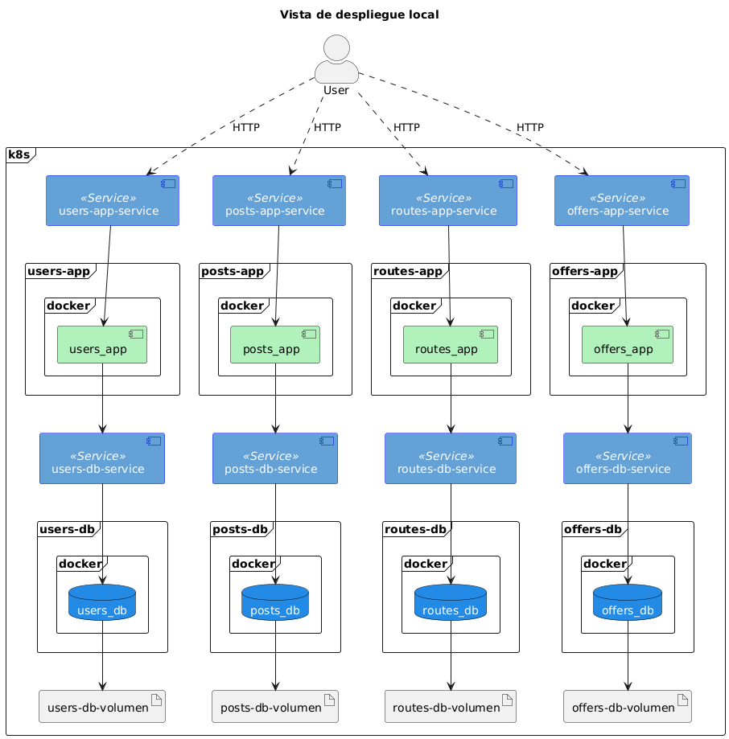
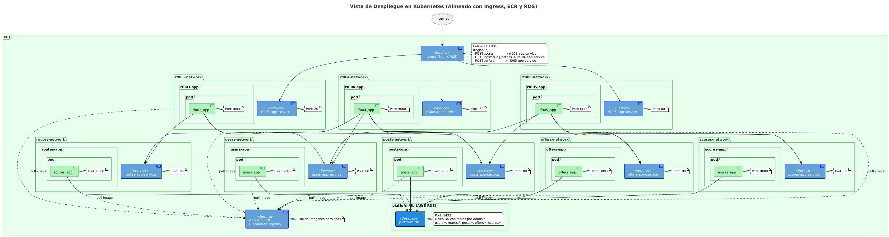
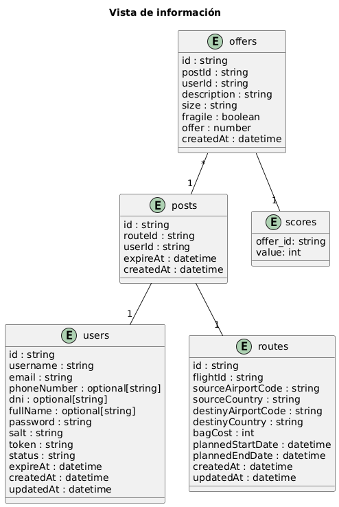

## Vista de despliegue

> **Modelo de despliegue:** describe cómo los **componentes funcionales** (RF-003/004/005 y servicios de dominio `users/routes/posts/offers/scores`) se **despliegan usando servicios de nube**.

## Entorno
- Kubernetes en **AWS** (p. ej., **EKS**).
- Todas las imágenes se publican y se **extraen desde Amazon ECR**.

## Acceso del usuario (entrada única)
Un **Ingress** (Nginx / AWS Load Balancer Controller + ALB) expone un punto HTTP(S) y enruta por **host/path** hacia los servicios **RF-003..RF-005**:
- `POST /posts` → **rf003-app-service** (Crear publicación)
- `GET /posts/{id}/details` → **rf004-app-service** (Ver publicación + ofertas)
- `POST /offers` → **rf005-app-service** (Crear oferta)

## Consumo directo de servicios de dominio (interno)
Además de ser llamados por los RF, los servicios de dominio (**users_app, routes_app, posts_app, offers_app, scores_app**) pueden **exponer sus propios endpoints** para Backoffice/integraciones mediante:
- **ClusterIP Services** (DNS interno de k8s), y/o
- **Reglas adicionales en el mismo Ingress** con **restricciones** (mTLS, IP allowlist, autenticación).
  
Rutas internas típicas: `/users/*`, `/routes/*`, `/posts/*`, `/offers/*`, `/scores/*`.

## Patrón de despliegue por servicio
- **Pod** por servicio con **Docker** encapsulando la app (`*_app`) y un **Service** delante (ClusterIP).
- Servicios **RF**: `rf003_app`, `rf004_app`, `rf005_app`.
- Servicios de **dominio**: `users_app`, `routes_app`, `posts_app`, `offers_app`, `scores_app`.

## Persistencia (única en la nube)
- **PostgreSQL en AWS (RDS)** como **única BD**: `platform_db`.
- Cada dominio **posee sus propias tablas/esquemas** (p. ej., `users.*`, `routes.*`, `posts.*`, `offers.*`, `scores.*`).
- **Sin llaves foráneas cruzadas** ni *joins* entre dominios; la coordinación entre dominios se hace **vía APIs**.
- **Sin PVC/PV** de BD en el clúster (la BD es gestionada por RDS). Conexión mediante **Secrets**.

## Comunicación entre servicios (HTTP/JSON síncrono)
- **RF003** → `users_app`, `routes_app`, `posts_app`
- **RF004** → `users_app`, `posts_app`, `offers_app`, `routes_app`, `scores_app`.
- **RF005** → `users_app`, `posts_app`, `offers_app`, `scores_app`.
- Los servicios de dominio también pueden ser **consumidos directamente** para sus propios endpoints (interno).

## Operación y escalado
- **Aislamiento y escalado independiente** por servicio (HPA, requests/limits de CPU/RAM).
- **Rolling updates**, *readiness/liveness probes*.
- **NetworkPolicy** para tráfico Este–Oeste; **RBAC** e **IRSA**/credenciales mínimas para acceder a RDS/ECR.
- **Observabilidad**: trazabilidad con `X-Request-Id`, métricas y trazas distribuidas; *timeouts* y *reintentos* con *backoff*.
- **Seguridad**: Bearer token en la capa RF; secretos gestionados.

## Idempotencia y consistencia
- Claves de idempotencia y **restricciones únicas** (p. ej., `(owner_id, route_id)` en publicaciones).
- Transacciones en RDS para **consistencia**; degradación controlada en lecturas de `scores_app` (retornar `score: null` si hay indisponibilidad).

---

## Servicios cloud usados
- **Amazon EKS** – Orquestación Kubernetes (Pods, Services, HPA, RBAC).
- **Ingress Controller** (Nginx / **AWS Load Balancer Controller** + **ALB**) – Entrada HTTP(S) y *routing* por host/path.
- **Amazon ECR** – Registro de imágenes de contenedor (pull desde los Pods).
- **Amazon RDS for PostgreSQL** – Base de datos única `platform_db`.
- **AWS Secrets Manager / Kubernetes Secrets** – Gestión de credenciales y cadenas de conexión.
- **AWS IAM / IRSA** – Permisos mínimos para Pods hacia servicios AWS (ECR/RDS/Secrets).
- **Amazon CloudWatch** – Logs y métricas (y/o Prometheus/Grafana para métricas/trazas).
- **AWS Certificate Manager (ACM)** – Certificados TLS para el Ingress/ALB.

# Vista de Redes

- **K8s con dominios lógicos (“networks”):** `users`, `posts`, `routes`, `offers`, `scores` y una **capa de APIs expuestas** (`rf003`, `rf004`, `rf005`).

- **Exposición externa:** **único Ingress** (Nginx/ALB). Flujo:  
  **Internet → Ingress → rf00x-app-service (HTTP :80) → pod rf00x_app → (interno) servicios de dominio**  
  (`users_app`, `routes_app`, `posts_app`, `offers_app`, `scores_app`, todos como **ClusterIP**).

- **Acceso a datos:** **una sola BD PostgreSQL (AWS RDS)** `platform_db`.  
  Cada servicio accede **solo a sus tablas/esquema** (p. ej., `users.*`, `routes.*`, `posts.*`, `offers.*`, `scores.*`).  
  **Sin llaves foráneas cruzadas ni joins** entre dominios; conexión mediante **Secrets**. *(Se eliminan los pods `*_db` y sus NodePorts.)*

- **Imágenes y nube:** Contenedores publicados en **Amazon ECR**; los Pods hacen *pull* con **IAM/IRSA**. El clúster corre en **EKS**.

- **Aislamiento y escalabilidad:** cada servicio se **despliega y escala** de forma independiente (HPA, requests/limits), manteniendo **propiedad de datos por dominio** y comunicación **HTTP/JSON** entre servicios.

# Vista de información

Modelo lógico de datos para la segunda iteración. Muestra entidades clave, atributos y relaciones.